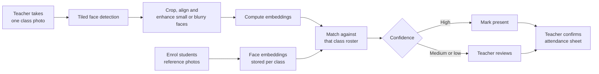

# Automated Attendance System

**A concept for teacher-controlled attendance from a single classroom photograph.**

> **Status: concept and design only.** This was a first hackathon project. The repository contains no code yet; it documents the problem, the proposed approach and the planned technology stack.

## Problem

Roll-call attendance consumes lecture time and is vulnerable to proxy attendance. Existing face-based systems typically require a fixed device at the door, or a kiosk where each student presents their face individually. This adds hardware and queues and places control with the device rather than the teacher.

## Proposed Solution

- **One photo per class.** The teacher photographs the room once; all visible students are processed from that image.
- **Teacher authority.** No fixed machine; the teacher decides when attendance is taken and confirms the result.
- **Phone-based.** Designed to be light enough for a teacher's phone.

## Technical Challenges

| Challenge | Impact |
|---|---|
| Small faces | In a wide shot, each face is a small patch of pixels |
| Blur | Hand shake and low light degrade facial detail |
| Occlusion | Students in front hide those behind them |
| Accuracy vs. size | The most accurate models are large; the target is a phone |

**Seating assumption:** tiered, university-style seating so each face is visible. It is not designed for flat classrooms where back-row faces are hidden.

## Planned Pipeline

1. **Enrol:** store face embeddings of reference photos rather than raw image galleries.
2. **Capture:** one high-resolution class photo.
3. **Detect:** split the image into overlapping tiles so distant faces are not missed.
4. **Enhance:** crop and align faces; improve low-quality crops where needed.
5. **Match:** compare each embedding only against the students enrolled in that class.
6. **Confidence tiers:** confident matches are marked automatically; uncertain ones are flagged (green / yellow / red).
7. **Confirm:** the teacher reviews flagged students and saves the sheet.

## Planned Technology Stack

Nothing below is implemented; models will be benchmarked before selection.

| Layer | Planned choice |
|---|---|
| Face detection | SCRFD / RetinaFace (InsightFace) or a YOLO-based detector |
| Small-face handling | Sliced (tiled) inference, SAHI-style |
| Face enhancement | Optional restoration (GFPGAN / CodeFormer), to be evaluated since restoration can alter identity features |
| Recognition | ArcFace-style embeddings; compact model such as MobileFaceNet for on-device use |
| Matching | Cosine similarity over per-class embeddings (FAISS or pgvector) |
| Mobile app | Flutter or React Native; TensorFlow Lite / ONNX Runtime Mobile |
| Backend | Python, FastAPI, PostgreSQL (+ pgvector) |
| ML tooling | PyTorch, OpenCV, NumPy |
| Spoof protection | Liveness / photo-of-a-photo detection |

## Evaluation Plan

Recall; precision and false-accept rate (must be very low); teacher effort per class; performance on real phones; robustness across lighting, blur and class size.

## Privacy and Consent

Faces are biometric data. A real deployment must obtain consent (and guardian consent for minors), comply with applicable law such as India's Digital Personal Data Protection Act, 2023, store embeddings rather than raw photos where possible, support deletion requests, and keep the teacher or institution in control.

## Roadmap

- [ ] Collect a small consented classroom-style dataset
- [ ] Benchmark detectors on small and blurry faces
- [ ] Benchmark recognition models for accuracy vs. size
- [ ] Build tiled detection and matching pipeline
- [ ] Build teacher mobile app (capture, review, confirm)
- [ ] Add confidence tiers and review screen
- [ ] Add liveness protection
- [ ] Pilot in a tiered-seating classroom

## Author

Pratham Bansal ([@prathambansaliasofficial-ai](https://github.com/prathambansaliasofficial-ai)). First hackathon project.
