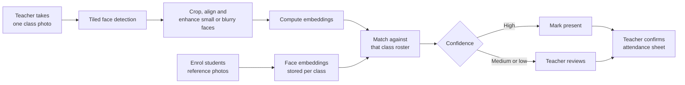

# Automated Attendance System

**One photo. The whole class. Attendance marked.**

A teacher-controlled attendance system. The teacher takes a single photo of the classroom, the system finds every face in it, matches each face against the enrolled student database, and produces an attendance sheet that the teacher reviews and confirms.

> **Status: concept and design.** This was our first hackathon project. The repository does not contain code yet; this document explains the problem, the approach and the **planned** technology stack.

---

## The problem

Taking attendance by roll call wastes lecture time and is easy to fake (proxy attendance). Existing face-based systems usually need a fixed machine at the door or a kiosk where every student walks up and shows their face one at a time. That means extra hardware, queues, and the *device* (not the teacher) holding the control.

## Our idea

- **One click, one photo.** The teacher photographs the class once; every visible student is processed from that single image.
- **Teacher keeps the authority.** No fixed machine. The teacher decides when attendance is taken and confirms the result.
- **Runs from a phone.** Technically heavy, but engineered to stay lightweight enough for a normal teacher's phone.

The idea is simple to state. The engineering is the hard part, and that is the point: our advantage is technical depth and the time invested in refining it.

## Why this is hard

| Challenge | Why it matters |
|---|---|
| **Small faces** | In a wide classroom shot, each face is only a small patch of pixels. |
| **Blur** | A teacher's phone camera, hand shake and low light all blur faces, but every student's facial detail still has to be matched. |
| **Occlusion** | Students in front hide students behind them. |
| **Accuracy vs. weight** | The most accurate models are large; the product must still run on a phone. |

It is essentially a deep-learning problem where every pixel of every face counts.

## Seating prerequisite

The system assumes **tiered, university-style seating** (rows stepped up like terraces), so that each student's face is visible to the camera.

It is **not** designed for flat classrooms where everyone sits at the same height in straight rows, because faces in the back rows are hidden.

## How it works (planned pipeline)

1. **Enrol**: capture reference photos of each student and store face embeddings (numeric fingerprints), not raw galleries.
2. **Capture**: the teacher takes one high-resolution photo of the class.
3. **Detect**: split the large photo into overlapping tiles so small, distant faces are not missed, then run face detection on each tile.
4. **Enhance**: crop and align each face; improve low-quality crops when needed.
5. **Match**: compare each face embedding only against the students enrolled in *that* class (a small gallery is faster and more accurate than searching the whole school).
6. **Confidence tiers**: confident matches are marked automatically; uncertain ones are flagged for the teacher (green / yellow / red).
7. **Confirm**: the teacher reviews flagged students and saves the attendance sheet.

## Planned technology stack

> These are the intended choices for building the idea. Nothing here is implemented yet, and models will be benchmarked before being finalised.

| Layer | Planned choice | Why |
|---|---|---|
| Face detection | SCRFD / RetinaFace (InsightFace) or a YOLO-based face detector | Strong at small faces; fast enough for mobile or server |
| Small-face handling | Sliced / tiled inference over the full-resolution photo (SAHI-style) | Keeps tiny faces from being lost when the image is downscaled |
| Face enhancement | Optional face restoration (e.g. GFPGAN / CodeFormer) for very blurry crops | Can help detection; **to be evaluated carefully**, because restoration can invent detail and hurt identity matching |
| Face recognition | ArcFace-style embeddings (InsightFace); a compact model such as MobileFaceNet for on-device use | State-of-the-art accuracy with a lightweight option |
| Matching | Cosine similarity over per-class embeddings (FAISS or pgvector) | Small per-class gallery keeps matching fast |
| Mobile app | Flutter or React Native | One codebase for the teacher's phone; full-resolution camera capture |
| On-device inference | TensorFlow Lite / ONNX Runtime Mobile | Keeps the system lightweight and works with weak connectivity |
| Backend | Python, FastAPI, PostgreSQL (+ pgvector) | Roster, enrolment, attendance records, optional heavy-model inference |
| ML tooling | Python, PyTorch, OpenCV, NumPy | Training, evaluation and image processing |
| Spoof protection | Liveness / photo-of-a-photo detection | Prevents proxy attendance using printed or on-screen photos |

## How we will measure success

- **Recall**: share of present students correctly detected and recognised.
- **Precision / false-accept rate**: how often a student is marked present wrongly (this must be very low).
- **Teacher effort**: time and taps needed per class, including review of flagged faces.
- **Performance on real phones**: end-to-end time and memory use.
- **Robustness**: results across lighting, blur levels and class sizes.

## Privacy and consent

Faces are biometric personal data. A real deployment must:

- obtain consent from students (and guardians for minors) and follow applicable law, such as India's Digital Personal Data Protection Act, 2023;
- store embeddings rather than raw photos wherever possible, and keep only what is needed;
- let students request deletion;
- keep the teacher or institution in control of when and how the system is used.

## Roadmap

- [ ] Collect a small consented dataset of classroom-style photos
- [ ] Benchmark face detectors on small and blurry faces
- [ ] Benchmark recognition models for accuracy vs. size
- [ ] Build the tiled-detection and matching pipeline
- [ ] Build the teacher's mobile app (capture, review, confirm)
- [ ] Add confidence tiers and teacher review screen
- [ ] Add spoof / liveness protection
- [ ] Pilot in a tiered-seating classroom

## Team

Built by Pratham Bansal ([@prathambansaliasofficial-ai](https://github.com/prathambansaliasofficial-ai)) as a first hackathon project.
